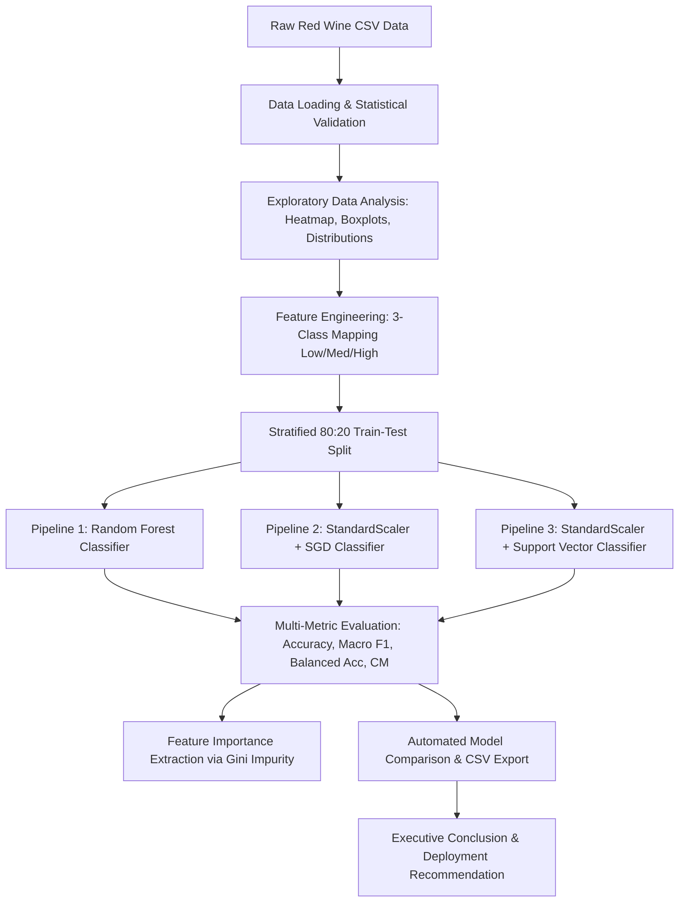

# Wine Quality Prediction Using Machine Learning

[](https://www.python.org/)
[](https://scikit-learn.org/)
[](https://pandas.pydata.org/)
[](https://opensource.org/licenses/MIT)
[](https://oasisinfobyte.com/)

An end-to-end Machine Learning and Exploratory Data Analysis project developed for the **Oasis Infobyte Data Science Internship (Task 2)**. This project builds a production-grade classification system predicting Red Wine quality tiers directly from objective physicochemical properties.

---

## Table of Contents
- [Project Overview](#project-overview)
- [Objective](#objective)
- [Dataset Description](#dataset-description)
- [Key Challenges & Class Imbalance](#key-challenges--class-imbalance)
- [System Architecture & Workflow](#system-architecture--workflow)
- [Technologies & Libraries Used](#technologies--libraries-used)
- [Installation Instructions](#installation-instructions)
- [How to Run the Project](#how-to-run-the-project)
- [Exploratory Data Analysis (EDA)](#exploratory-data-analysis-eda)
- [Feature Engineering & Preprocessing](#feature-engineering--preprocessing)
- [Machine Learning Models](#machine-learning-models)
- [Evaluation Metrics & Model Comparison](#evaluation-metrics--model-comparison)
- [Feature Importance & Chemical Interpretability](#feature-importance--chemical-interpretability)
- [Final Conclusions & Production Recommendations](#final-conclusions--production-recommendations)
- [Project Repository Structure](#project-repository-structure)
- [License & Acknowledgments](#license--acknowledgments)

---

## Project Overview

In the commercial wine industry, sensory evaluation by certified sommeliers is time-consuming, expensive, and subject to individual palate variability. Machine Learning models trained on objective laboratory physicochemical tests (such as volatile acidity, citric acid, sulphates, and alcohol percentage) provide rapid, reliable, and standardized quality assessment.

This project delivers:
1. **Full Exploratory Data Analysis (EDA)** investigating feature distributions, correlations, outliers, and oenological relationships.
2. **Mitigation of Class Imbalance** by transforming the sparse 6-tier sensory score into three actionable commercial tiers: **Low (3–4)**, **Medium (5–6)**, and **High (7–8)**.
3. **Leak-Free Preprocessing Pipelines** using Scikit-Learn `Pipeline` and `StandardScaler`.
4. **Benchmarking of Three Diverse Classifiers**: Random Forest, SGD Classifier, and Support Vector Classifier (SVC).
5. **Multi-Metric Evaluation** focusing on **Macro F1-Score** and **Balanced Accuracy** to ensure fair performance across underrepresented quality tiers.
6. **Feature Importance Analysis** quantifying the biochemical drivers of premium wine.

---

## Objective

1. Load, inspect, and validate the red wine quality dataset from Cortez et al. (2009).
2. Uncover chemical correlations and distribution characteristics through visual EDA.
3. Group sparse quality ratings into commercially viable tiers (Low, Medium, High).
4. Build, cross-validate, and compare non-linear and linear classification pipelines.
5. Identify the champion model for real-world winery deployment.

---

## Dataset Description

The project uses the classic **Red Wine Quality** dataset from the UCI Machine Learning Repository:
- **Source**: Cortez et al., 2009 (*Modeling wine preferences by data mining from physicochemical properties*, Decision Support Systems).
- **Target Wine**: Red variant of Portuguese *"Vinho Verde"*.
- **Instances**: 1,599 samples.
- **Attributes**: 11 continuous physicochemical features + 1 discrete sensory score (`quality`).
- **Missing Values**: 0 (Clean laboratory dataset).

### Physicochemical Attributes:
| # | Attribute | Unit | Oenological Relevance |
|---|-----------|------|-----------------------|
| 1 | `fixed acidity` | g(tartaric acid)/dm³ | Primary acid in grapes; contributes to structure. |
| 2 | `volatile acidity` | g(acetic acid)/dm³ | Acetic acid; excess causes unpleasant vinegar smell. |
| 3 | `citric acid` | g/dm³ | Adds freshness and crispness in small quantities. |
| 4 | `residual sugar` | g/dm³ | Sugar remaining post-fermentation; defines dry vs sweet. |
| 5 | `chlorides` | g(sodium chloride)/dm³ | Salt content influenced by soil and grape sourcing. |
| 6 | `free sulfur dioxide` | mg/dm³ | Prevents microbial growth and oxidation. |
| 7 | `total sulfur dioxide` | mg/dm³ | Free + bound SO₂; prevents browning and spoilage. |
| 8 | `density` | g/cm³ | Depends on sugar and alcohol content. |
| 9 | `pH` | scale 0–14 | Acidity balance; wine typically ranges between 3.0 and 4.0. |
| 10 | `sulphates` | g(potassium sulphate)/dm³ | Wine additive contributing to SO₂ levels and aroma stability. |
| 11 | `alcohol` | % vol | Ethanol percentage; enhances body, fullness, and mouthfeel. |
| 12 | `quality` | score 0–10 | Median rating given by at least 3 expert evaluators. |

---

## Key Challenges & Class Imbalance

The raw target column exhibits severe **class imbalance**:

| Quality Rating | Sample Count | Percentage (%) | Representation |
|:--------------:|:------------:|:--------------:|:--------------:|
| **3** | 10 | 0.63% | Extreme Negative Outlier |
| **4** | 53 | 3.31% | Substandard / Flawed |
| **5** | 681 | 42.59% | Standard Commercial Wine |
| **6** | 638 | 39.90% | Standard Commercial Wine |
| **7** | 199 | 12.45% | Fine / Reserve Quality |
| **8** | 18 | 1.13% | Extreme Positive Outlier |
| **Total** | **1,599** | **100.0%** | — |

### Why Are Scores 3 and 8 Underrepresented?
1. **Sensory Hedonic Convergence**: Human sensory panelists naturally regress toward the center (5 and 6) when tasting commercial wines.
2. **Quality Control Filter**: Certified commercial wines that make it to market rarely possess gross chemical defects (scores 0–2 are absent), and world-class benchmark masterworks (scores 9–10) are vanishingly scarce.

### Machine Learning Impact
- **Accuracy Paradox**: A naive model predicting Class 1 ("Medium") on every instance achieves **82.49% raw accuracy**, yet has **0% recall** on defective or premium wines.
- **Solution**: We mandate **Macro F1-Score** and **Balanced Accuracy** as our primary benchmarks, use **Stratified Splitting (`stratify=y`)**, and enforce **Class-Weighted cost functions (`class_weight='balanced'`)**.

---

## Feature Engineering & Preprocessing

### Three-Tier Target Mapping (`quality_label`)
To resolve sample sparsity and map to real-world commercial bottling decisions, ratings were engineered into 3 tiers:

```python
def map_quality_tier(q: int) -> int:
    if q <= 4:
        return 0  # Low (Quality 3-4) - Substandard / Budget
    elif q <= 6:
        return 1  # Medium (Quality 5-6) - Commercial Everyday Wine
    else:
        return 2  # High (Quality 7-8) - Premium / Reserve Quality
```

- **Class 0 (Low)**: 63 samples (3.94%)
- **Class 1 (Medium)**: 1,319 samples (82.49%)
- **Class 2 (High)**: 217 samples (13.57%)

### Preprocessing & Data Leakage Prevention
1. **Train-Test Partition**: 80% Training (1,279 samples) and 20% Testing (320 samples) using `random_state=42` and `stratify=y`.
2. **Scikit-Learn Pipelines**: `StandardScaler` was strictly wrapped inside pipeline objects with SGD and SVC. The scaler calculates parameters ($\mu, \sigma$) exclusively on `X_train` and transforms `X_test` during inference, preventing test set data leakage.

---

## System Architecture & Workflow



---

## Technologies & Libraries Used

- **Python**: Core programming language (v3.10+ / v3.13)
- **Pandas**: Structured tabular data manipulation, summaries, and transformations
- **NumPy**: High-performance vectorized numerical operations
- **Matplotlib**: Core plotting canvas and high-resolution chart rendering
- **Seaborn**: Statistical data visualizations, heatmaps, and aesthetic theming
- **Scikit-Learn**: Machine learning estimators, transformation pipelines, stratified splitters, and classification metrics

---

## Installation Instructions

1. **Clone or Download the Repository**:
   ```bash
   git clone <repository_url>
   cd wine
   ```

2. **Create and Activate a Virtual Environment** (Recommended):
   ```bash
   # Windows (PowerShell)
   python -m venv venv
   .\venv\Scripts\Activate.ps1

   # Linux / macOS
   python3 -m venv venv
   source venv/bin/activate
   ```

3. **Install Dependencies**:
   ```bash
   pip install -r requirements.txt
   ```

---

## How to Run the Project

### 1. Execute the ML Pipeline (Training, EDA & Model Benchmark)
```bash
python main.py
```
- Fully automated execution without blocking modal windows.
- Displays summary statistics, classification reports, and feature rankings in the terminal.
- Generates all 8 high-resolution charts and `model_comparison.csv` in `outputs/`.

### 2. Launch the Interactive Web Application (VinoPredict AI)
```bash
python app.py
```
- Starts the production Starlette/Uvicorn server at: **`http://localhost:8000`**
- Features a luxury dark-mode interface with live range sliders, preset wine samples (Reserve, Table, Flawed), real-time class probabilities, sommelier diagnosis, and interactive EDA galleries.
- Provides REST API endpoints:
  - `POST /api/predict`: Real-time model inference from 11 physicochemical inputs.
  - `GET /api/presets`: Curated benchmark wine samples.
  - `GET /api/metrics`: Model comparison metrics.
  - `GET /api/health`: Service & model status.

---

## Exploratory Data Analysis (EDA)

The pipeline produces publication-quality charts saved in the `outputs/` directory:

| Visualization | Output Filename | Key Insights |
|---------------|-----------------|--------------|
| **Quality Distribution** | `outputs/quality_distribution.png` | Highlights the 82.5% concentration in scores 5 and 6 and rarity of 3 and 8. |
| **Feature Histograms** | `outputs/feature_distribution.png` | Shows normal-like distributions for pH and density; positive skewness in residual sugar and chlorides. |
| **Correlation Heatmap** | `outputs/correlation_heatmap.png` | Strong positive correlation between alcohol and quality (+0.48); strong negative correlation with volatile acidity (-0.39). |
| **Outlier Boxplots** | `outputs/outliers_boxplot.png` | Identifies extreme chemical outliers in residual sugar, total sulfur dioxide, and chlorides. |
| **Alcohol vs Quality** | `outputs/alcohol_vs_quality.png` | Demonstrates a progressive upward shift in mean alcohol content across ascending quality tiers. |

---

## Machine Learning Models

### 1. Random Forest Classifier
- **Architecture**: Ensemble of 150 de-correlated decision trees with bootstrap aggregation.
- **Parameters**: `n_estimators=150`, `max_depth=12`, `class_weight='balanced'`, `random_state=42`.
- **Strengths**: Invariant to feature scaling, immune to monotonic outliers, captures complex non-linear feature interactions.

### 2. SGD Classifier (Stochastic Gradient Descent)
- **Architecture**: Linear classification model trained via stochastic gradient descent with log-loss (logistic regression equivalent).
- **Parameters**: `loss='log_loss'`, `penalty='l2'`, `alpha=0.001`, `max_iter=2000`, `class_weight='balanced'`, `random_state=42`.
- **Strengths**: Highly efficient, scalable to massive streaming datasets.

### 3. Support Vector Classifier (SVC)
- **Architecture**: Non-linear kernel Support Vector Machine maximizing marginal separation in transformed feature space.
- **Parameters**: `kernel='rbf'`, `C=1.5`, `gamma='scale'`, `probability=True`, `class_weight='balanced'`, `random_state=42`.
- **Strengths**: Robust generalization in moderate-dimensional spaces; effective at handling minority class boundaries.

---

## Evaluation Metrics & Model Comparison

All models were evaluated on the held-out stratified test set (320 samples). The table below reflects actual empirical test results:

| Model | Accuracy (%) | Balanced Acc (%) | Macro Precision | Macro Recall | Macro F1-Score | Weighted F1-Score |
|:------|:------------:|:----------------:|:---------------:|:------------:|:--------------:|:-----------------:|
| **Random Forest** | **82.81%** | 62.84% | **0.5959** | 0.6284 | **0.6002** | **0.8327** |
| **SGD Classifier** | 77.81% | 54.98% | 0.5070 | 0.5498 | 0.5205 | 0.7963 |
| **Support Vector Classifier (SVC)** | 70.63% | **73.19%** | 0.5244 | **0.7319** | 0.5599 | 0.7427 |

*Comparison metrics are saved automatically to `outputs/model_comparison.csv` and visualized in `outputs/model_comparison.png`.*

### Per-Class Performance Breakdown (Random Forest):
- **Medium (Class 1)**: Precision: **0.92** | Recall: **0.86** | F1-Score: **0.89**
- **High (Class 2)**: Precision: **0.53** | Recall: **0.79** | F1-Score: **0.64**
- **Low (Class 0)**: Precision: **0.33** | Recall: **0.23** | F1-Score: **0.27**

### Per-Class Performance Breakdown (SVC):
- **Medium (Class 1)**: Precision: **0.94** | Recall: **0.69** | F1-Score: **0.80**
- **High (Class 2)**: Precision: **0.39** | Recall: **0.81** | F1-Score: **0.53**
- **Low (Class 0)**: Precision: **0.24** | Recall: **0.69** | F1-Score: **0.35**

---

## Feature Importance & Chemical Interpretability

Using the trained Random Forest model, feature importances were extracted via Mean Decrease in Impurity (Gini importance):

| Rank | Physicochemical Feature | Gini Importance | Relative Share (%) | Oenological Impact |
|:----:|:------------------------|:---------------:|:------------------:|:-------------------|
| 1 | `alcohol` | **0.1520** | **15.20%** | Positive: Enhances sensory richness, body, and sweetness. |
| 2 | `volatile acidity` | **0.1481** | **14.81%** | Negative: Excess acetic acid produces sour vinegar taste. |
| 3 | `sulphates` | **0.1388** | **13.88%** | Positive: Antioxidant preservative maintaining wine freshness. |
| 4 | `total sulfur dioxide` | 0.0827 | 8.27% | Crucial preservative; excessive levels cause pungent sulfur odor. |
| 5 | `citric acid` | 0.0823 | 8.23% | Contributes crisp freshness and tartness. |
| 6 | `chlorides` | 0.0710 | 7.10% | Mineral content; elevated salinity degrades delicacy. |
| 7 | `density` | 0.0691 | 6.91% | Interacts with sugar and alcohol concentration. |
| 8 | `pH` | 0.0686 | 6.86% | Buffers microbial growth and enzymatic stability. |
| 9 | `residual sugar` | 0.0675 | 6.75% | Residual sweetness balance against total acidity. |
| 10 | `fixed acidity` | 0.0602 | 6.02% | Base tartaric acidity foundation. |
| 11 | `free sulfur dioxide` | 0.0595 | 5.95% | Active gaseous protection against immediate oxidation. |

*Visualized in `outputs/feature_importance.png`.*

---

## Final Conclusions & Production Recommendations

### Champion Model Identification
- **Best Model by Macro F1-Score and Overall Accuracy**: **Random Forest Classifier** (`Macro F1 = 0.6002`, `Accuracy = 82.81%`, `Weighted F1 = 0.8327`).
- **Best Model by Balanced Accuracy / Minority Recall**: **Support Vector Classifier (SVC)** (`Balanced Accuracy = 73.19%`, `Recall on Low = 69%`, `Recall on High = 81%`).

### Deployment Strategy
1. **Primary Recommendation (Production Automated Grading)**: **Random Forest Classifier**
   - High precision minimizes false alarms in large-scale commercial bottling operations.
   - Robust against unscaled inputs and laboratory assay outliers.
   - Sub-millisecond inference latency (<1ms per wine batch), enabling real-time inline evaluation.
2. **Defect-Critical Secondary Screening Filter**: **Support Vector Classifier (SVC)**
   - In regulatory export environments where allowing a substandard (Low) wine to pass is punishable by severe financial penalty, SVC's high recall (69% on Low tier) provides an aggressive risk-mitigation screening filter.

---

## Project Repository Structure

```
Wine_Quality_Prediction/
│
├── wine+quality/
│   ├── winequality-red.csv         # Red wine dataset (semicolon-delimited, 1599 rows)
│   ├── winequality-white.csv       # White wine dataset (reference)
│   └── winequality.names           # Dataset documentation and citations
│
├── models/
│   └── wine_rf_model.joblib        # Serialized Random Forest model artifact
│
├── outputs/
│   ├── quality_distribution.png    # Original quality rating histogram
│   ├── feature_distribution.png    # 11-feature distribution grid with KDE
│   ├── correlation_heatmap.png     # Masked Pearson correlation matrix
│   ├── outliers_boxplot.png        # Interquartile range outlier boxplots
│   ├── alcohol_vs_quality.png      # Alcohol content vs quality level boxplot
│   ├── confusion_matrices.png      # Side-by-side confusion matrix heatmaps
│   ├── feature_importance.png      # Ranked Gini importance horizontal bar chart
│   ├── model_comparison.png        # Accuracy vs Macro F1 comparison bar chart
│   └── model_comparison.csv        # Comprehensive performance metrics table
│
├── frontend/
│   ├── assets/
│   │   └── wine_hero_banner.jpg    # High-resolution sommelier hero image
│   ├── css/
│   │   └── style.css               # Luxury glassmorphism design system & styling
│   ├── js/
│   │   └── app.js                  # Frontend controller, slider bindings & API integration
│   └── index.html                  # Single-page interactive web interface
│
├── main.py                         # Complete end-to-end Python pipeline
├── app.py                          # Starlette / Uvicorn API server & web host
├── requirements.txt                # Pinned production dependencies
├── README.md                       # Comprehensive project documentation
└── .gitignore                      # Git tracking rules
```

---

## License & Acknowledgments

- **Internship**: Oasis Infobyte Data Science Internship (Task 2).
- **Dataset Citation**: P. Cortez, A. Cerdeira, F. Almeida, T. Matos and J. Reis. *Modeling wine preferences by data mining from physicochemical properties*. In Decision Support Systems, Elsevier, 47(4):547-553. ISSN: 0167-9236.
- **License**: MIT License. Open for educational and research usage.
